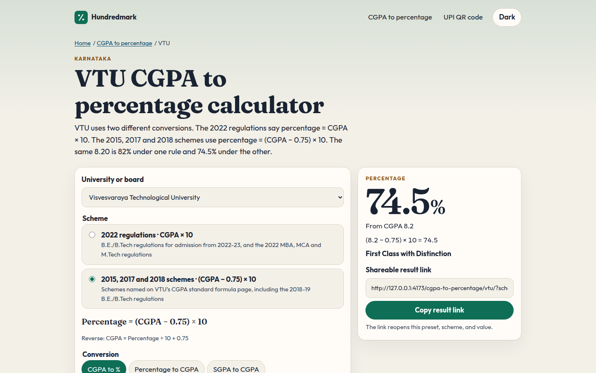
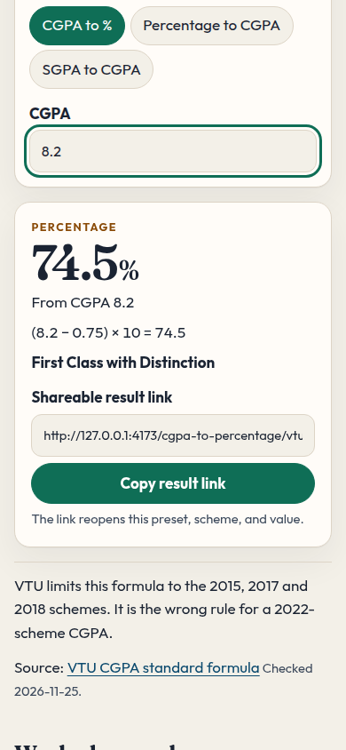
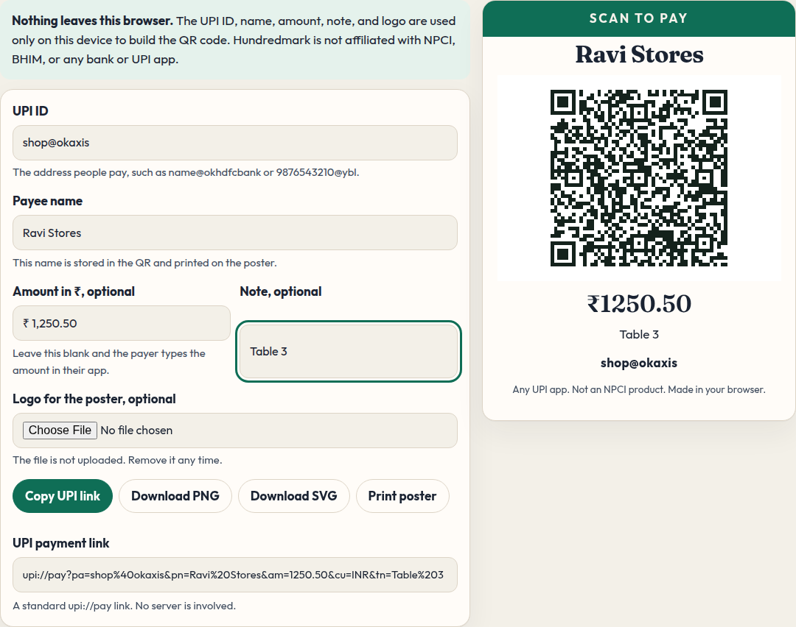
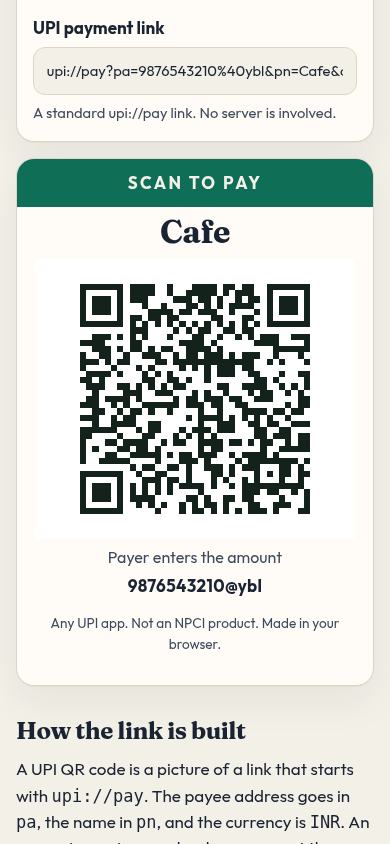
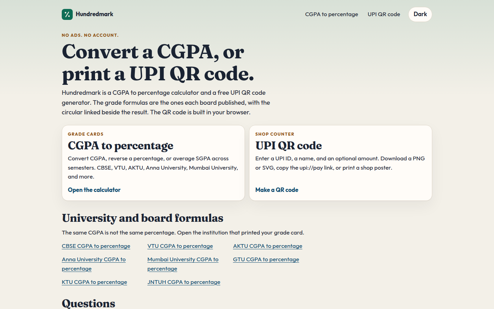
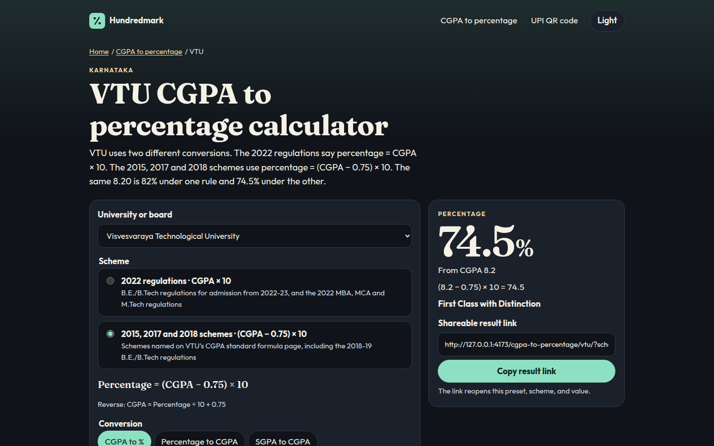

# Hundredmark

A static site with two tools aimed at real search demand in India:

- **CGPA to percentage**, including percentage back to CGPA and a credit-weighted SGPA average
- **Free UPI QR code generator**, built entirely in the browser

Every university formula is quoted from the board or university document that states it. The UPI ID, name, amount, note, and logo never leave the device. Hundredmark is not affiliated with any university, NPCI, BHIM, or UPI app.









The homepage, in dark mode as well as light:





## Tools

### CGPA to percentage

`/cgpa-to-percentage/` and one page per institution, for example `/cgpa-to-percentage/vtu/`.

| Preset | Default formula | Source |
| --- | --- | --- |
| CBSE | CGPA × 9.5 | Circular No. 24, 28 May 2010 |
| VTU | CGPA × 10, or (CGPA − 0.75) × 10 | 2022 regulations, and the 2015–2018 standard formula |
| AKTU | CGPA × 10 | Revised B.Tech ordinance, clause 15 |
| Anna University | CGPA × 10 | Regulations 2021, clause 15.5.3 |
| Mumbai University | 7.1 × CGPA + 11, or 7.25 × CGPI + 11, then round up | Circulars of 26 June 2019 and October 2018 |
| GTU | (CGPA − 0.5) × 10 | Notification 1/2012 |
| KTU | 10 × CGPA, or the older 10 × CGPA − 2.5 | U.O. No. 1584/2023/KTU |
| JNTUH | (CGPA − 0.5) × 10 | R22 regulations, clause 11.2 |

A custom multiplier and adjustment cover anything else. All of the numbers live in [`src/data/presets.ts`](src/data/presets.ts). A result link reopens the same institution, scheme, and value.

### UPI QR code

`/upi-qr-code-generator/` checks the UPI ID shape, then builds a `upi://pay` link with `pa`, `pn`, `cu=INR`, and `am` / `tn` only when those fields are filled. Download a PNG or SVG, copy the link, or print the poster. The poster can include a logo read from the device. It is not uploaded.

## Develop

```bash
npm install
npm test
npm run dev
```

`npm test` covers the formulas, the SGPA average, Mumbai University’s round-up, and the UPI link builder. `npm run typecheck` runs the TypeScript compiler.

```bash
npm run build
```

The static site is written to `out/`. A small post-build step copies each Open Graph image to `opengraph-image.png` so a static host serves it with an image extension.

Lighthouse, against a server that compresses responses: performance 97–99, accessibility 100, best practices 100, SEO 100 on the homepage, the VTU page, and the UPI page. Accessibility was also checked with axe (WCAG 2.1 AA) in light and dark mode, on a desktop width and a phone width.

## Deploy

The site is a Next.js static export, so it can sit on GitHub Pages or Vercel.

Set these at build time:

| Variable | GitHub Pages project site | Vercel or a user site |
| --- | --- | --- |
| `NEXT_PUBLIC_SITE_URL` | `https://<owner>.github.io` | `https://your-domain.example` |
| `NEXT_PUBLIC_BASE_PATH` | `/<repo>` | empty |

Canonical URLs are baked in at build time. If `NEXT_PUBLIC_SITE_URL` is left unset, they point at `http://localhost:3000`.

GitHub Actions:

- [`.github/workflows/ci.yml`](.github/workflows/ci.yml) runs tests, the type check, and the build on every push and pull request.
- [`.github/workflows/pages.yml`](.github/workflows/pages.yml) publishes `out/` to GitHub Pages when `main` changes. In the repository settings, set Pages → Source to GitHub Actions.

On Vercel, import the repository, leave the base path empty, and set `NEXT_PUBLIC_SITE_URL` to the production URL. The Next.js preset picks up `output: 'export'`.

## Privacy

Both tools run in the browser. There is no account and no analytics script. The theme choice is the only value stored in local storage. Fonts are downloaded with the site, not from a third party at view time. Details are on the privacy page.

Formulas were read from the linked documents on 25 November 2026. A university can change a rule. Use the document your grade card or the form in front of you names.
